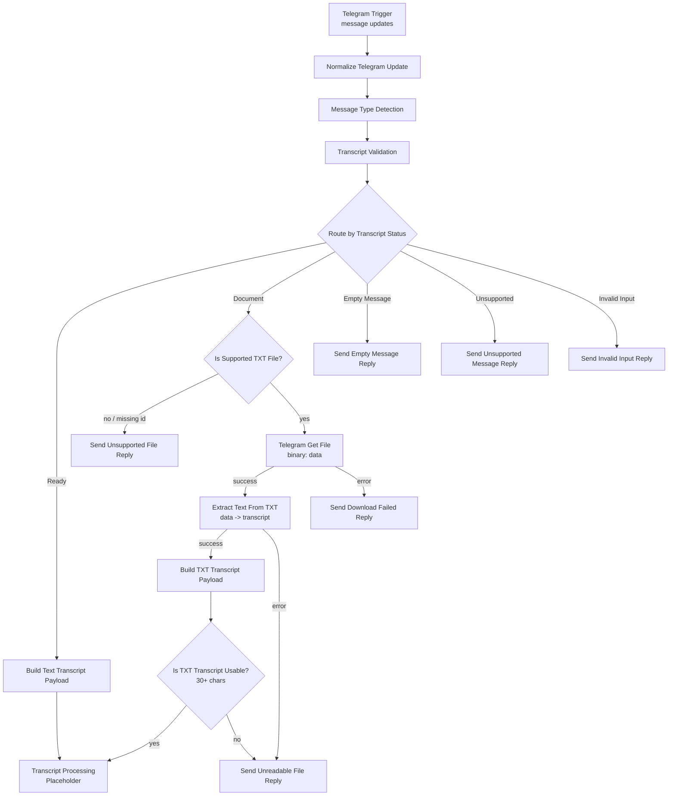

# Architecture — Rasamalai Meeting-to-Action Bot

## Runtime

| Item | Value |
|---|---|
| n8n | 2.46.4 |
| Deployment | Local Docker (`n8nio/n8n:latest`) |
| Public endpoint | ngrok HTTPS tunnel |
| Workflow timezone | `Asia/Kolkata` |
| User interface | Telegram bot |
| Primary workflow | `Rasamalai - Meeting-to-Action MVP` (`ebk0jMAStBUcYLa8`) |
| Workflow state | Inactive (not published) |

## Design principles

1. **The AI Agent only extracts.** It receives a transcript and returns structured JSON. It never holds Telegram or Google Sheets tools.
2. **All side effects are deterministic n8n nodes.** Sending messages and writing rows are plain Telegram / Google Sheets nodes wired in the graph, so they can be audited and retried.
3. **One workflow.** All phases extend `Rasamalai - Meeting-to-Action MVP`; no sub-workflows.
4. **One transcript contract.** Every input path produces the same payload before AI processing.

## Current pipeline (Phases 1–2)



`Transcript Processing (Placeholder)` is the join point. Phase 3 replaces it with the AI extraction chain, so both text and `.txt` inputs enter the LLM through the same node.

## Transcript contract

Both `Build Text Transcript Payload` and `Build TXT Transcript Payload` emit exactly:

```json
{
  "chat_id": 111222333,
  "user_id": 111222333,
  "message_id": 42,
  "source_type": "text",
  "transcript": "Alice: We agreed to ship the MVP by Friday.",
  "meeting_timestamp": "2026-11-07T05:20:00.000Z"
}
```

- `source_type` is `text` or `txt`.
- `meeting_timestamp` is the Telegram message date in ISO 8601 (UTC).
- TXT metadata is restored from `Transcript Validation` via `$('Transcript Validation').item.json`, because the Telegram API response replaces the item JSON during download.

## Node inventory (as built)

| Node | Type | Version | Role |
|---|---|---|---|
| Telegram Trigger | `n8n-nodes-base.telegramTrigger` | 1.5 | Receives `message` updates |
| Normalize Telegram Update | `n8n-nodes-base.code` | 2 | Flattens the update; extracts ids, text, document fields, flags |
| Message Type Detection | `n8n-nodes-base.code` | 2 | `text` / `document` / `empty` / `unsupported` + extension |
| Transcript Validation | `n8n-nodes-base.code` | 2 | Rejects empty, unsupported, commands and short text; classifies documents |
| Route by Transcript Status | `n8n-nodes-base.switch` | 3.5 | 4 rules + fallback |
| Build Text Transcript Payload | `n8n-nodes-base.code` | 2 | Common payload, `source_type = text` |
| Transcript Processing (Placeholder) | `n8n-nodes-base.noOp` | 1 | Phase 3 insertion point |
| Is Supported TXT File? | `n8n-nodes-base.if` | 2.4 | `.txt` extension **and** non-empty file id |
| Telegram Get File | `n8n-nodes-base.telegram` | 1.2 | `file:get`, `download: true` |
| Extract Text From TXT | `n8n-nodes-base.extractFromFile` | 1.2 | `text` operation |
| Build TXT Transcript Payload | `n8n-nodes-base.code` | 2 | Common payload, `source_type = txt` |
| Is TXT Transcript Usable? | `n8n-nodes-base.if` | 2.4 | 30-character minimum |
| Send Empty Message Reply | `n8n-nodes-base.telegram` | 1.2 | Rejection reply |
| Send Unsupported Message Reply | `n8n-nodes-base.telegram` | 1.2 | Rejection reply |
| Send Invalid Input Reply | `n8n-nodes-base.telegram` | 1.2 | Rejection reply |
| Send Unsupported File Reply | `n8n-nodes-base.telegram` | 1.2 | Non-`.txt` rejection |
| Send Download Failed Reply | `n8n-nodes-base.telegram` | 1.2 | Download failure |
| Send Unreadable File Reply | `n8n-nodes-base.telegram` | 1.2 | Extraction failure / empty text |

## Binary handling

Verified against the installed n8n 2.46.4 node source, not assumed:

- **Telegram `file:get` with `download: true`** writes the file to binary property **`data`**, names it from `file_path`, and derives MIME type from the extension.
- **Extract from File v1.2** (`operation: text`) reads `binaryPropertyName` (default `data`) and writes decoded UTF-8 text to `destinationKey`. This workflow sets `destinationKey: transcript` and `keepSource: json`.
- The workflow uses `binaryMode: separate`, which n8n sets when binary data is present.

## Error handling (current)

| Failure | Detection | Response |
|---|---|---|
| Empty message | `message_kind = empty` | Empty message reply |
| Sticker / photo / other media | `message_kind = unsupported` | Unsupported message reply |
| Bot command | `is_bot_command` | Invalid input reply |
| Text under 30 characters | `text.length` | Invalid input reply |
| Non-`.txt` document or missing file id | `Is Supported TXT File?` | Unsupported file reply |
| Telegram download failure | `onError: continueErrorOutput` | Download failed reply |
| Extraction failure | `onError: continueErrorOutput` | Unreadable file reply |
| Extracted text under 30 characters | `Is TXT Transcript Usable?` | Unreadable file reply |

## Credentials

Credential IDs are deliberately stripped from `workflows/meeting-to-action.json`.

After importing, assign:

| Credential | Type | Used by |
|---|---|---|
| Telegram bot | `telegramApi` | Trigger + 7 Telegram nodes |
| NVIDIA Nemotron | `nvidiaApi` | Phase 3 chat model |
| Google Sheets | `googleSheetsOAuth2Api` | Phase 4 storage |

## Planned Phase 3+ shape

```
Transcript Processing
  → AI Agent (NVIDIA Nemotron Chat Model + Structured Output Parser)
  → parse/validate structured result
  → Google Sheets append (deterministic)
  → Telegram summary (deterministic)
```

The parser schema will include: summary, decisions, action items (task, owner, deadline, status), open questions, and confidence/flags for missing owners or deadlines.
