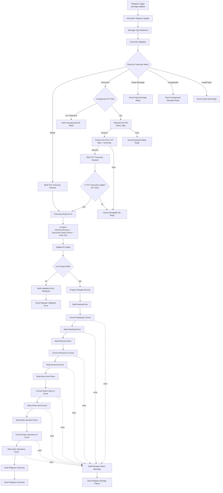

# Architecture — Rasamalai Meeting-to-Action Bot

## Runtime

| Item | Value |
|---|---|
| n8n | 2.46.4 |
| Deployment | Local Docker (`n8nio/n8n:latest`) |
| Public endpoint | ngrok HTTPS tunnel |
| Workflow timezone | `Asia/Kolkata` |
| User interface | Telegram bot |
| Primary workflow | `Rasamalai - Meeting-to-Action MVP` (`ebk0jMAStBUcYLa8`) |
| Workflow state | Inactive (not published) |

## Design principles

1. **The AI Agent only extracts.** It receives a transcript and returns structured JSON. It never holds Telegram, file-writing or storage tools.
2. **All side effects are deterministic n8n nodes.** Sending messages and writing files are plain Telegram / file nodes wired in the graph, so they can be audited and retried.
3. **One workflow.** All phases extend `Rasamalai - Meeting-to-Action MVP`; no sub-workflows.
4. **One transcript contract.** Every input path produces the same payload before AI processing.
5. **No success without proof.** The summary is only sent after every storage write is verified.

## Current pipeline (Phases 1–6)



`Transcript Ready for AI` is the join point: both text and `.txt` inputs enter the AI chain through the same node.

## Transcript contract

Both `Build Text Transcript Payload` and `Build TXT Transcript Payload` emit exactly:

```json
{
  "chat_id": 111222333,
  "user_id": 111222333,
  "message_id": 42,
  "source_type": "text",
  "transcript": "Alice: We agreed to ship the MVP by Friday.",
  "meeting_timestamp": "2026-11-07T05:20:00.000Z"
}
```

- `source_type` is `text` or `txt`.
- `meeting_timestamp` is the Telegram message date in ISO 8601 (UTC).
- TXT metadata is restored from `Transcript Validation` via `$('Transcript Validation').item.json`, because the Telegram API response replaces the item JSON during download.

## AI output and validation

`AI Agent` returns JSON with `summary`, `decisions`, `action_items` and `open_questions`.

`Validate AI Output` is the trust boundary. It:

- parses string output (including fenced JSON) and rejects malformed results;
- normalizes enums (`status`, `confidence`, `assignment_type`);
- normalizes owners to `Unassigned` and forces `confidence: Low` for unowned tasks;
- resolves deadlines against the meeting date in `Asia/Kolkata`:
  absolute dates, weekdays (`next Friday`), relative phrases (`tomorrow`, `in 3 days`),
  and vague wording (`soon`, `ASAP`, `TBD`) — recording `deadline_status`
  (`resolved`, `vague`, `ambiguous`, `conflicting`, `missing`, `unresolved`) and flags;
- detects the same task repeated with different deadlines.

Invalid output stops the run and sends a validation error reply; nothing is stored.

## Deterministic identifiers

```
meeting_id  = <chat_id>_<message_id>
decision_id = <meeting_id>_D<n>
task_id     = <meeting_id>_T<n>
question_id = <meeting_id>_Q<n>
```

`meeting_id` is shared by every table so rows can be joined. Re-processing the same
Telegram message produces the same ids.

## Storage

Storage is four Excel workbooks per meeting, written under
`<n8n data folder>/exports`:

| File | Sheet | Columns |
|---|---|---|
| `<meeting_id>_Meetings.xlsx` | Meetings | `meeting_id`, `meeting_date`, `source_chat_id`, `submitted_by`, `summary`, `transcript_hash` |
| `<meeting_id>_Decisions.xlsx` | Decisions | `decision_id`, `meeting_id`, `decision`, `evidence` |
| `<meeting_id>_ActionItems.xlsx` | ActionItems | `task_id`, `meeting_id`, `task`, `owner`, `deadline`, `status`, `confidence`, `assignment_type`, `evidence`, `notes` |
| `<meeting_id>_OpenQuestions.xlsx` | OpenQuestions | `question_id`, `meeting_id`, `question`, `related_task`, `resolution_status` |

- `deadline` holds the resolved ISO date when one exists, otherwise the original wording.
  The original wording, status and flags are appended to `notes`.
- `transcript_hash` is a pure-JS SHA-256 of the transcript (no crypto module needed).
- One file per table rather than one workbook with four sheets: the stock
  `Convert to File` node writes a single sheet only.
- A table with no rows still produces its file with correct headers and one blank row,
  which keeps the write chain linear.
- Writes are idempotent per `meeting_id`: re-running a meeting overwrites its own files.

## Node inventory (as built)

### Intake and validation

| Node | Type | Version | Role |
|---|---|---|---|
| Telegram Trigger | `n8n-nodes-base.telegramTrigger` | 1.5 | Receives `message` updates |
| Normalize Telegram Update | `n8n-nodes-base.code` | 2 | Flattens the update; extracts ids, text, document fields, flags |
| Message Type Detection | `n8n-nodes-base.code` | 2 | `text` / `document` / `empty` / `unsupported` + extension |
| Transcript Validation | `n8n-nodes-base.code` | 2 | Rejects empty, unsupported, commands and short text; classifies documents |
| Route by Transcript Status | `n8n-nodes-base.switch` | 3.5 | 4 rules + fallback |
| Build Text Transcript Payload | `n8n-nodes-base.code` | 2 | Common payload, `source_type = text` |
| Transcript Ready for AI | `n8n-nodes-base.noOp` | 1 | Join point for both input paths |
| Is Supported TXT File? | `n8n-nodes-base.if` | 2.4 | `.txt` extension **and** non-empty file id |
| Telegram Get File | `n8n-nodes-base.telegram` | 1.2 | `file:get`, `download: true` |
| Extract Text From TXT | `n8n-nodes-base.extractFromFile` | 1.2 | `text` operation |
| Build TXT Transcript Payload | `n8n-nodes-base.code` | 2 | Common payload, `source_type = txt` |
| Is TXT Transcript Usable? | `n8n-nodes-base.if` | 2.4 | 30-character minimum |
| Send Empty Message Reply | `n8n-nodes-base.telegram` | 1.2 | Rejection reply |
| Send Unsupported Message Reply | `n8n-nodes-base.telegram` | 1.2 | Rejection reply |
| Send Invalid Input Reply | `n8n-nodes-base.telegram` | 1.2 | Rejection reply |
| Send Unsupported File Reply | `n8n-nodes-base.telegram` | 1.2 | Non-`.txt` rejection |
| Send Download Failed Reply | `n8n-nodes-base.telegram` | 1.2 | Download failure |
| Send Unreadable File Reply | `n8n-nodes-base.telegram` | 1.2 | Extraction failure / empty text |

### AI extraction

| Node | Type | Version | Role |
|---|---|---|---|
| AI Agent | `@n8n/n8n-nodes-langchain.agent` | 3.1 | Extraction agent |
| NVIDIA Nemotron Chat Model | `@n8n/n8n-nodes-langchain.lmChatNvidia` | 1 | `nvidia/nemotron-3-nano-omni-30b-a3b-reasoning` |
| Structured Output Parser | `@n8n/n8n-nodes-langchain.outputParserStructured` | 1.3 | Forces the JSON schema |
| Think Tool | `@n8n/n8n-nodes-langchain.toolThink` | 1.1 | Reasoning scratchpad |
| Validate AI Output | `n8n-nodes-base.code` | 2 | Validation, normalization, deadline resolution |
| Is AI Output Valid? | `n8n-nodes-base.if` | 2.4 | Branch on `validation_status` |
| Build Validation Error Response | `n8n-nodes-base.code` | 2 | Human-readable validation failure |
| Send Telegram Validation Error | `n8n-nodes-base.telegram` | 1.2 | Sends the validation failure |

### Storage and summary

| Node | Type | Version | Role |
|---|---|---|---|
| Prepare Storage Records | `n8n-nodes-base.code` | 2 | Deterministic ids, IST date, SHA-256 hash, per-table rows |
| Build Meeting Row | `n8n-nodes-base.code` | 2 | Meetings row |
| Build Decision Rows | `n8n-nodes-base.code` | 2 | Decision rows (headers-only fallback) |
| Build Action Item Rows | `n8n-nodes-base.code` | 2 | Action item rows (headers-only fallback) |
| Build Open Question Rows | `n8n-nodes-base.code` | 2 | Open question rows (headers-only fallback) |
| Convert … to Excel ×4 | `n8n-nodes-base.convertToFile` | 1.2 | JSON → `.xlsx` binary |
| Write … Excel ×4 | `n8n-nodes-base.readWriteFile` | 1.1 | Writes the binary to disk |
| Build Telegram Summary | `n8n-nodes-base.code` | 2 | Verifies writes, builds and splits the summary |
| Send Telegram Summary | `n8n-nodes-base.telegram` | 1.2 | One message per chunk |
| Build Storage Failure Message | `n8n-nodes-base.code` | 2 | Turns a write error into a reply |
| Send Telegram Storage Failure | `n8n-nodes-base.telegram` | 1.2 | Sends the storage failure |

## Binary handling

Verified against the installed n8n 2.46.4 node source, not assumed:

- **Telegram `file:get` with `download: true`** writes the file to binary property **`data`**, names it from `file_path`, and derives MIME type from the extension.
- **Extract from File v1.2** (`operation: text`) reads `binaryPropertyName` (default `data`) and writes decoded UTF-8 text to `destinationKey`. This workflow sets `destinationKey: transcript` and `keepSource: json`.
- **Convert to File v1.2** (`operation: xlsx`) aggregates all input items into one sheet and returns a single item with `json: {}` and the workbook in binary property `data`. Expressions on the write node therefore reference the builder node, not `$json`.
- The workflow uses `binaryMode: separate`, which n8n sets when binary data is present.

## File access configuration

n8n blocks its file nodes from arbitrary paths by default. The Docker container must be
started with:

```
-e N8N_BLOCK_FILE_ACCESS_TO_N8N_FILES=false
-e N8N_RESTRICT_FILE_ACCESS_TO=/home/node/.n8n/exports
```

`N8N_RESTRICT_FILE_ACCESS_TO` defaults to `~/.n8n-files` in n8n 2.x, so without it every
write fails with `Access to the file is not allowed.` Mounting the n8n data folder on the
host makes the exports directly visible:

```
-v "C:\path\to\n8n-data:/home/node/.n8n"
```

## Error handling

| Failure | Detection | Response |
|---|---|---|
| Empty message | `message_kind = empty` | Empty message reply |
| Sticker / photo / other media | `message_kind = unsupported` | Unsupported message reply |
| Bot command | `is_bot_command` | Invalid input reply |
| Text under 30 characters | `text.length` | Invalid input reply |
| Non-`.txt` document or missing file id | `Is Supported TXT File?` | Unsupported file reply |
| Telegram download failure | `onError: continueErrorOutput` | Download failed reply |
| Extraction failure | `onError: continueErrorOutput` | Unreadable file reply |
| Extracted text under 30 characters | `Is TXT Transcript Usable?` | Unreadable file reply |
| Invalid or malformed AI output | `Is AI Output Valid?` | Validation error reply; nothing stored |
| Excel conversion failure | `onError: continueErrorOutput` | Storage failure reply; no summary |
| Excel write failure | `onError: continueErrorOutput` | Storage failure reply; no summary |
| Partial write (count mismatch) | `Build Telegram Summary` | Storage-incomplete reply; no summary |

Storage errors are never reported as success: a failed write diverts the chain to the
failure branch, and the summary node independently re-checks that all four files exist
and that row counts match before it sends anything.

## Credentials

Credential IDs are deliberately stripped from `workflows/meeting-to-action.json`.

After importing, assign:

| Credential | Type | Used by |
|---|---|---|
| Telegram bot | `telegramApi` | Trigger + 11 Telegram nodes |
| NVIDIA Nemotron | `nvidiaApi` | Chat model |

No Google credential is required: storage is plain `.xlsx` files on disk.

## Summary format

`Build Telegram Summary` emits one consolidated message per successful meeting:

```
MEETING SUMMARY

Summary:
<summary>

KEY DECISIONS
- ...

ACTION ITEMS
1. <task>
   Owner: <owner>
   Deadline: <resolved date or original wording>

DEADLINES NEEDING REVIEW
- <task> — "<original wording>" (<status>)

OPEN QUESTIONS
- ...

UNASSIGNED TASKS
- ...
```

Messages are split at 3800 characters (Telegram's hard limit is 4096) and each part is
suffixed `— part i/n`. Plain text is used deliberately, so transcript-derived content
cannot break HTML parsing.
